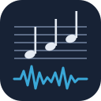
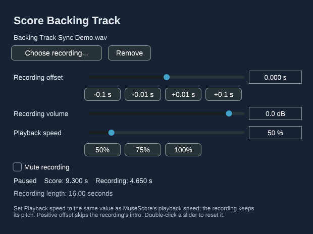

<div align="center">



# Score Backing Track

**Play the recording you're transcribing in sync with MuseScore Studio's playback.**

[](https://github.com/AlltAWD/score-backing-track/actions/workflows/build.yml)
[](https://github.com/AlltAWD/score-backing-track/releases)
[](LICENSE)
[](#install)
[](https://steinbergmedia.github.io/vst3_dev_portal/)
[](https://musescore.org)

[Install](#install) · [Usage](#usage) · [Limitations](#limitations) · [Building](#building-from-source) · [Roadmap](#roadmap) · [Contributing](#contributing)



</div>

> [!IMPORTANT]
> **Version 0.1 is an early release with two hard limits:**
> - **Playback speed must be 100%.** MuseScore doesn't tell effects about its
>   speed setting, so at any other speed the recording drifts away from the score.
> - **Linux and Windows only for now.** There is no macOS build yet.

## Why

When you transcribe, you're constantly comparing what you've written with the
original. MuseScore can play your score, but it can't play the original
alongside it. Score Backing Track can: load the recording once, line it up,
and every time you press Play (or play from a selected bar) the recording
starts from the matching point.

## Features

- 🎧 **Follows MuseScore's playhead.** Play, pause, play from a selection, and
  seeking all stay in sync, with no clicking "start" in a second app.
- 🎚️ **Mix or compare.** Hear the recording alongside your score, or mute your
  own part in the Mixer to check it against the original by ear.
- ⏱️ **Fine alignment.** A recording offset you can type in or nudge by
  ±0.01 s / ±0.1 s.
- 💾 **Saved with the score.** The recording's location, offset and volume are
  stored in the `.mscz`. The audio stays an external file.
- 📂 **Common formats.** WAV, MP3, FLAC, OGG and AIFF, at any sample rate.
- 🧩 **No extra software.** A VST3 effect that runs inside MuseScore's own
  audio engine. There's no companion app, QML plugin or background service.

## Install

| Platform | Status | VST3 folder |
| --- | --- | --- |
| **Linux** (x86-64) | ✅ Tested on Ubuntu 24.04 with MuseScore Studio 4.7.5 | `~/.vst3/` |
| **Windows** (x64) | ⚠️ Built and unit-tested by CI, not yet tested by a person in MuseScore | `C:\Program Files\Common Files\VST3\` |
| **macOS** | ❌ Not available yet | n/a |

1. Download the zip for your platform from the
   [latest release](https://github.com/AlltAWD/score-backing-track/releases/latest).
2. Extract it. You get a folder named `Score Backing Track.vst3`. Copy the
   **whole folder** (not just the file inside it) into the VST3 folder above.
3. Restart MuseScore Studio.

## Usage

1. Open the Mixer (**F10**).
2. In the **Master** channel's audio-effects slot, add
   **AlltAWD → Score Backing Track**.
3. In the effect's window, click **Choose recording...**.
4. Press Play. The recording follows MuseScore's playhead.
5. Align the recording with **Recording offset**:
   - a **positive** offset skips the recording's intro;
   - a **negative** offset delays the recording.

   Type a value, or use the ±0.01 s / ±0.1 s buttons. Double-click a slider to
   reset it.

> [!TIP]
> To hear only the recording, mute the score's instruments in the Mixer. Keep
> **Master** unmuted, because that's where the recording plays.

Save the score to keep the recording's location and settings. If you move the
audio file later, the editor shows which file is missing so you can choose it
again.

## Limitations

- **Playback speed must be 100%.** To slow a passage down, you currently need
  to slow the recording itself in another tool and load that.
- **Linux and Windows only.** No macOS build yet.
- **Turn count-in off.** It shifts the score relative to the recording.
- **The score's timing has to match the recording.** There's no beat mapping:
  tempo changes, repeats, jumps and fermatas in the score that the recording
  doesn't have (or vice versa) will drift.
- **Audio-device latency hasn't been measured.** If the recording sounds
  slightly early or late against the score, nudge the offset.

## How it works

The plugin decodes the recording on a background thread. In MuseScore's audio
callback it reads the host's playhead position and mixes in the matching slice
of the recording, resampling if the file's sample rate differs from the
engine's. The audio thread never waits on a lock and never allocates or frees
memory. More detail is in [native/README.md](native/README.md).

## Building from source

Requires CMake 3.22+ and a C++17 compiler. On Linux you also need JUCE's
development packages (ALSA, freetype/fontconfig, X11; see
[the CI workflow](.github/workflows/build.yml) for the exact list).

```bash
cmake -S native -B native/build -DCMAKE_BUILD_TYPE=Release
cmake --build native/build --config Release
ctest --test-dir native/build -C Release   # use xvfb-run on a headless Linux machine
python3 native/scripts/install_native.py   # copies the bundle to your VST3 folder
```

CMake downloads [JUCE 7.0.12](https://github.com/juce-framework/JUCE/tree/7.0.12)
automatically. End-to-end checks against a real MuseScore install are
described in [native/README.md](native/README.md#verification) and
[VERIFICATION.md](VERIFICATION.md). `demo/` contains an eight-bar score and a
matching recording for trying it out.

## Roadmap

- [ ] Practice-speed support (pitch-preserving time-stretch)
- [ ] macOS build
- [ ] Windows testing in MuseScore
- [ ] Waveform view for easier alignment
- [ ] Better handling of repeats and jumps

## Contributing

Bug reports, test results (especially on Windows) and pull requests are
welcome. Please [open an issue](https://github.com/AlltAWD/score-backing-track/issues)
and include your OS, MuseScore version, and the audio format you used.

## License

Score Backing Track is licensed under the [GNU GPL v3.0](LICENSE). It's built
with [JUCE](https://juce.com) 7 under JUCE's GPLv3 open-source license.

VST is a registered trademark of Steinberg Media Technologies GmbH. MuseScore
is a trademark of Muse Group. This project is independent and not affiliated
with or endorsed by either.
